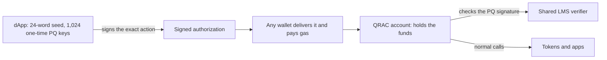

# QRAC (QR Accounts)

Post-quantum accounts for Ethereum that you can use today, and that already work with EIP-8141 frame transactions.

QRAC is a dApp plus a few contracts. You create a 24-word seed, the dApp turns it into 1,024 post-quantum one-time keys (LMS, RFC 8554, hash based), and you mint a small smart account whose only owner is that post-quantum key. Your funds live in the account. To move them you sign the exact action with a one-time key, and the account checks that signature on-chain before doing anything.

- **Today (Sepolia):** any wallet can deliver your signed action and pay the gas, but no wallet owns the account. If the ECDSA key of that wallet leaks, or one day gets broken by a quantum computer, it still can't move a single wei out of your account.
- **With frame transactions (EIP-8141 devnet):** the same idea without the ECDSA wallet. The transaction carries only the post-quantum signature, the account approves and pays its own gas, and the protocol itself makes sure each one-time key is used once. The post-quantum check needs about 250k gas of validation, which the public mempool refuses (limit 100k) and the ERC-8421 alternative mempool accepts.

Testnets only. Not audited.

## Live evidence

| What | Where |
|---|---|
| PQ-signed transfer from a QRAC account on Sepolia | [0x0538b564…abb5c](https://sepolia.etherscan.io/tx/0x0538b564be006bfb5d70cd8b0d1d2fa60045863fc53fa41ef6d60735005abb5c) |
| Account minted through the factory on Sepolia (738k gas instead of 10.5M) | [records](deployments/11155111.md) |
| PQ frame transaction admitted by the alternative mempool (all rules passed) | [explorer](https://explorer.altmempool.wtf/tx/0x2f414a944f74a803e5d3e59eb98e9bd56f2c0a6e87be9bcf5cfa42e65026f4f0) |
| Same transaction rejected by the public mempool, attacks rejected live | [records](deployments/1337.md) |

## How it works



1. The seed is 256 bits of fresh randomness (24 BIP-39 words). It has nothing to do with your Ethereum wallet.
2. From the seed the dApp derives a separate key tree for each chain, account number and key epoch. The tree root is the account's public key.
3. You mint the account through the factory. It is a 45-byte clone of shared logic, and you know its address before it exists.
4. To act, the dApp reserves a fresh one-time key (saved before signing, never reused), signs the full action (chain, account, nonce, calls, optional allowed sender, expiry) and sends it.
5. The account verifies the signature with the shared verifier, marks the key and the nonce as used, and runs the calls all-or-nothing.
6. Before the 1,024 keys run out, the current key authorizes a new tree (rotation).

In frame mode, steps 4 and 5 change: the signature goes inside the EIP-8141 transaction, the account's VERIFY frame checks it and calls APPROVE, the account pays the gas, and the one-time key index is used as an EIP-8250 nonce key, so the network refuses a second use of it.

## Today and tomorrow, same account

`QRACFrameAccount` is the normal QRAC account (unchanged) plus native frame-transaction validation. It works with today's transactions through `submit()`, and on the EIP-8141 devnet it validates frame transactions directly (the account even staked itself through `submit()` and then used frame transactions).

If that contract is deployed on a chain today, the same address and the same funds can keep working when frame transactions arrive. The condition is that the final EIP-8141 keeps the opcodes and parameters of the current devnet, because the account has no upgrade path (by design: nobody, not even us, can change it). The Sepolia accounts minted so far use the plain `QRACAccount`. They keep working through `submit()` in any case, but they will not validate frame transactions natively.

What QRAC does not claim: privacy, MEV protection, compatibility with apps that only accept EOAs or ECDSA permits, or audited security.

## Numbers

| | |
|---|---|
| Post-quantum signature check | 172k to 220k gas, signature of 2,508 bytes |
| Account action on Sepolia (one transfer) | about 507k gas |
| Creating an account on Sepolia | 10.5M gas standalone, 738k gas minted (14x cheaper) |
| VERIFY frame on the devnet | about 250k gas (public mempool limit: 100k) |
| Key tree in the browser | 1,024 keys in 1 to 3.5 s, one signature in a few ms |
| Tests | 101 Python tests, 11 browser checks, manual runs on Sepolia and on the devnet |

## Try it

Run the site locally (or upload `apps/web` to any static host):

```bash
py -m http.server 8080 --directory apps/web
```

Open http://localhost:8080. The switch at the top has two modes:

- **Current Ethereum · Sepolia:** create a seed, connect Brave Wallet or MetaMask, mint an account, fund it and send a PQ-signed action.
- **Future Ethereum · EIP-8141 frame transactions:** no wallet extension needed. Create a devnet setup key, use the faucet, mint, fund, sign, and compare the public mempool (rejected) with the alternative mempool (admitted).

Step by step, with what you should see at each step: [docs/TEST-GUIDE.md](docs/TEST-GUIDE.md). Browser self-test: `/test.html`.

The 24 words are stored in the browser (developer mode) and in the seed file you download. The journal file (downloaded after each signature) has no secrets but you need it, together with the seed file, to keep signing from another browser.

## Repository

```text
contracts/       LMSVerifier, QRACAccount, QRACFactory, QRACFrameAccount, QRACFrameFactory
                 vendor/hegota-support: helpers for the EIP-8141 opcodes (MIT, unmodified)
apps/web/        the dApp: plain HTML, CSS and JavaScript, no build step
tools/           Python: reference LMS signer, frame tx codec, tests, local node, devnet script
deployments/     what is deployed where, with transaction links (Sepolia, devnet)
docs/            test guide, feedback for the alt-mempool team
qrac-ai-handoff/ project brief, plan, pitch notes and the vitácora (decision log)
```

Contracts compile with default Remix settings (solc 0.8.28). The dApp can also deploy them itself.

## Development

Tools needed: Python 3 and a browser. No Node.js, Foundry or Hardhat.

```bash
py -m venv .venv
```

```bash
.venv\Scripts\python -m pip install -r tools/requirements.txt
```

```bash
.venv\Scripts\python tools/run_tests.py
```

Other scripts:

- `tools/devnode.py`: local chain plus the dApp on port 8545, for offline demos.
- `tools/devnet.py`: the frame-transaction flow from the command line (`init`, `fund`, `deploy`, `mint`, `send`, `stake`, `attacks`, `status`).
- `tools/build_web_artifacts.py` and `tools/gen_web_fixtures.py`: run them after changing a contract or a Python reference.

## References

- [RFC 8554: Leighton-Micali hash-based signatures](https://www.rfc-editor.org/rfc/rfc8554.html)
- [BIP-39: mnemonic code](https://github.com/bitcoin/bips/blob/master/bip-0039.mediawiki)
- [EIP-8141: Frame Transaction](https://eips.ethereum.org/EIPS/eip-8141)
- [ERC-8421: alternative mempools (draft)](https://raw.githubusercontent.com/forshtat/ERCs/refs/heads/pr-clean/ERCS/erc-8421.md)
- [EIP-8250: keyed nonces](https://eips.ethereum.org/EIPS/eip-8250)
- [ERC-1167: minimal proxy](https://eips.ethereum.org/EIPS/eip-1167)
- [Alt-mempool docs and devnet](https://docs.altmempool.wtf/)

## License

[MIT](LICENSE)
