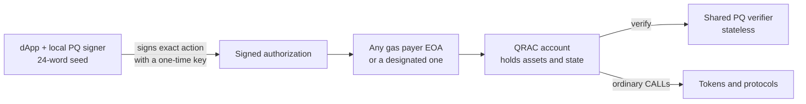

# QRAC — QR Accounts

**Post-quantum authorization for Ethereum accounts, on today's EVM.**

QRAC is a personal smart-contract account controlled by a **post-quantum (hash-based) signature** instead of an ECDSA key. Your assets and protocol positions belong to the account contract. Every action (a transfer, an approval, a protocol call or a batch of calls) must carry a valid one-time PQ signature over the exact action. Any wallet can pay the gas to deliver it, but no wallet owns the account.

If a quantum computer, or a plain leak, exposes the ECDSA key of the wallet that deployed or funded the account, that key **still can't move anything** out of it.

> Built for ETHGlobal. Status: **early development**. Nothing in this repo has been audited. Use test networks and test funds only.

---

## Why

- Ethereum EOAs authorize everything with ECDSA (secp256k1), which a sufficiently capable quantum computer could break.
- Waiting for protocol-level migration takes years. Smart accounts can adopt a different authorization rule **today**.
- If the check lives **inside the user's account**, existing contract-compatible protocols need no integration at all: they just see a normal caller.

## How it works



1. **Seed.** The dApp generates 24 BIP-39 words (256 bits of fresh entropy), independent of any Ethereum wallet.
2. **Key tree.** From the seed it derives a Merkle tree of one-time signing keys (LMS / LM-OTS, RFC 8554). The tree's root is the account's public key.
3. **Account.** The account stores the root, an epoch, an action nonce and which one-time keys were already used.
4. **Authorize.** To act, the signer reserves a fresh one-time key, signs the full action (chain, account, nonce, calls, optional allowed submitter, validity window) and saves its state *before* sending.
5. **Execute.** Any EOA submits the authorization. The account checks the signature through the shared verifier, consumes the key and the nonce, then runs the calls atomically.
6. **Renew.** Before the tree runs out, the current key authorizes a new root (new epoch).

### Security claim, scoped

After a trustworthy enrollment, possession or quantum recovery of the original ECDSA key **alone** does not authorize spending or configuration changes. A valid, current PQ authorization is required. Out of scope: device compromise and phishing, plus each external protocol's own admin powers and allowances.

What QRAC does **not** claim: full privacy, MEV protection, compatibility with every app (EOA-only checks and ECDSA-only permit flows remain exceptions), Safe feature parity or audited security.

## Roadmap

| Phase | What | Status |
|---|---|---|
| **1 — MVP** | Shared PQ **verifier** contract · user **account** PoC (single PQ authority, calls and atomic batches, replay protection) · **dApp** in plain HTML/CSS/JS with no backend (signer state in `localStorage` plus a JSON backup download after each signature, developer mode) · tests, gas benchmark, local demo | ✅ Done: local and **on Sepolia** ([PQ-signed transfer](https://sepolia.etherscan.io/tx/0x0538b564be006bfb5d70cd8b0d1d2fa60045863fc53fa41ef6d60735005abb5c), [records](deployments/11155111.md)) |
| **2 — Mint** | On-chain **factory** so anyone can mint (deploy and initialize atomically) their own QRAC account from the dApp: a 45-byte clone of shared logic, address known before minting | ✅ Done: local and **on Sepolia**, creating an account is ≈ 14× cheaper ([records](deployments/11155111.md)) |
| **3 — Frame transactions** | Native validation of **EIP-8141 frame transactions** (`VERIFY` frame → `APPROVE`), submitted through the **ERC-8421 alternative mempool** on the hackathon devnet. PQ verification needs more than the public mempool's 100k verification-gas budget, so the alt mempool is what makes it possible. | Planned |

### Measured so far (local EVM, LMS H10/W4)

| | |
|---|---|
| Post-quantum signature check | ~172k–220k gas · 2,508-byte signature |
| Full account action (send, token transfer, 5-call batch, cancel, rotate) | ~285k–345k gas per transaction |
| Browser key generation / signing | 1,024 one-time keys in ~1–2.3 s (Web Worker) · one signature in ~2–15 ms |
| Creating an account (Sepolia) | standalone 10.5M gas → **minted 738k gas (≈ 14× cheaper)** · local: 1.61M → 168k |
| Tests | 77 Python tests (incl. RFC 8554 vectors on-chain, a simulated compromise of the deployer's ECDSA key, and every account test repeated on minted clones) + 10 browser self-test checks + end-to-end dApp runs |

Details and methodology: [vitácora](qrac-ai-handoff/05-VITACORA.md).

## Repository layout

```text
contracts/          Solidity sources (compile and deploy with Remix)   — Phase 1
apps/web/           dApp: static HTML + CSS + JS, no build step        — Phase 1
                    (test.html = browser self-test)
tools/              Python: reference LMS signer, tests, local dev node — Phase 1
docs/               architecture notes, benchmarks, demo instructions  — as produced
deployments/        deployment records per chain id (Sepolia: 11155111.md)
qrac-ai-handoff/    project brief, plan, acceptance criteria, pitch and the decision log (vitácora)
```

## Getting started

Requirements: a browser, [Remix IDE](https://remix.ethereum.org), a wallet with Sepolia test ETH, and [Python 3](https://www.python.org/downloads/). No Node.js, Foundry or Hardhat. On Windows, use the `py` launcher if `python` opens the Microsoft Store.

**Contracts (Remix, default compiler settings, solc 0.8.24 or later):**

1. Deploy `contracts/LMSVerifier.sol` once per chain (the signature maths, shared by everyone).
2. Deploy `contracts/QRACFactory.sol` once per chain with `verifier_` = the address from step 1 (put `QRACAccount.sol` in the same Remix workspace; the factory deploys the shared, locked account logic itself).
3. Mint your account: `mint(publicKey)` with your 56-byte LMS public key (the dApp generates it from your seed: Account tab → "Generate key tree"). `predictAddress(publicKey)` tells you the address beforehand.
4. Fund the account by sending ETH or tokens to its address (even before minting). From then on, only PQ-signed authorizations submitted through `submit()` can move them.

The dApp does all of this with your connected wallet (Setup → "Deploy verifier" / "Deploy factory", Account → "Mint account"). A standalone account (full contract, Phase 1 style) is still possible: deploy `QRACAccount.sol` with `verifier` and `initialPublicKey`.

**dApp with a browser wallet (MetaMask, Brave Wallet…) on Sepolia:** the dApp must be served over `http://localhost` (browsers block the key-generation worker on `file://`). Any of these works, they serve the same files:

- `http://localhost:8080` after running the static server below, or
- `http://localhost:8545` while the local dev node (next section) is running.

```bash
py -m http.server 8080 --directory apps/web
```

Choose "Browser wallet" and connect. On Sepolia the shared verifier and factory are already deployed and pre-filled ([addresses](deployments/11155111.md)).

Flow: **Setup** (create a seed, which downloads a secret seed file, or import one; connect the wallet; verifier and factory are pre-filled or can be deployed) → **Account** (generate key tree, see your address, mint, fund) → **Compose & sign** (ETH / ERC-20 / raw calls, batch, who may submit, validity) → review → sign → submit or export → **Activity** → **Manage** (cancel, rotate, journal download and import).

**Fully local demo, no wallet or testnet needed:** the dev node serves the dApp and a local chain with 10 unlocked test EOAs and the verifier already deployed. Open http://localhost:8545 and choose "Local dev node":

```bash
.venv\Scripts\python tools/devnode.py
```

**Browser self-test:** open `/test.html` on either server to check this browser's SHA-256, LMS, BIP-39, key derivation and encoding against the Python references and the official vectors.

> Developer mode: the 24 words are kept in the browser's localStorage and in the downloaded seed file (keep it secret). The journal JSON downloaded after each signature contains no secrets but is required, together with the seed file, to keep signing safely on another browser.

**Tests and gas benchmark** (optional, local in-memory EVM):

```bash
py -m venv .venv
```

```bash
.venv\Scripts\python -m pip install -r tools/requirements.txt
```

```bash
.venv\Scripts\python tools/run_tests.py
```

After changing a contract or a Python reference, regenerate the dApp's compiled artifacts and the self-test fixtures:

```bash
.venv\Scripts\python tools/build_web_artifacts.py
```

```bash
.venv\Scripts\python tools/gen_web_fixtures.py
```

Networks: **Sepolia** for Phases 1–2; the hackathon frame-transaction devnet for Phase 3.

## Project documents

- [Start here](qrac-ai-handoff/00-START-HERE.md)
- [Project brief and architecture](qrac-ai-handoff/01-PROJECT-BRIEF.md)
- [Execution plan](qrac-ai-handoff/02-EXECUTION-PLAN.md)
- [Acceptance criteria and capability matrix](qrac-ai-handoff/03-ACCEPTANCE-AND-CAPABILITIES.md)
- [Pitch outline](qrac-ai-handoff/04-PITCH-OUTLINE.md)
- [Vitácora — decision log](qrac-ai-handoff/05-VITACORA.md)

## References

- [RFC 8554 — Leighton-Micali hash-based signatures (LMS)](https://www.rfc-editor.org/rfc/rfc8554.html)
- [BIP-39 — mnemonic code](https://github.com/bitcoin/bips/blob/master/bip-0039.mediawiki)
- [EIP-8141 — Frame Transaction](https://eips.ethereum.org/EIPS/eip-8141)
- [ERC-8421 — Standard alternative mempool (draft)](https://raw.githubusercontent.com/forshtat/ERCs/refs/heads/pr-clean/ERCS/erc-8421.md)
- [ERC-1167 — Minimal proxy](https://eips.ethereum.org/EIPS/eip-1167)
- [Ethereum quantum-resistance overview](https://ethereum.org/roadmap/security/quantum-resistance/)

## License

[MIT](LICENSE)
