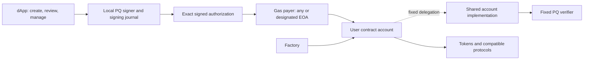

# QRAC — project brief and architecture

Version 1.0 · 6 November 2026 · architecture handoff, not implemented product.

## 1. Product in one paragraph

A user creates a personal contract account on an existing EVM chain. Its assets and protocol positions belong to the contract address. An independently generated post-quantum (PQ) signing authority authorizes exact actions. Any gas-paying EOA can submit an authorization in open mode, or the signature can restrict submission to one address. The account verifies the PQ signature and its replay policy before transferring assets or calling another protocol. A factory creates lightweight accounts sharing a fixed implementation, with separate state for each user. A dApp provides account creation, a 24-word mnemonic, transaction composition and review, signing, submission, activity, and key renewal.

This is a single focused hackathon proof of concept. Safe is a reference for useful account functions, not a codebase commitment, compatibility promise, brand affiliation, or claim of full feature parity.

## 2. Research discussion: what changed and why

| Discussion stage | Original idea or claim | Result of clarification |
|---|---|---|
| Initial QRAC service | Protocols call one contract to verify a disposable quantum-resistant signature associated with an EOA. | Feasible in principle using existing EVM execution, but every participating protocol must enforce it correctly. |
| Public challenge and secret | Register “SOMETHING,” reveal “OTHER SOMETHING” to authorize. | Use an actual specified signature scheme. The public part is a verification key/commitment; the private part must sign the exact operation, not merely reveal a reusable bearer secret. |
| Address binding | tx.origin identifies the owner and prevents hijacking. | The redesigned account has its own identity. Use signed account/chain/action domains; direct submission restrictions use msg.sender. tx.origin is not an ownership mechanism. |
| Enrollment | Attach an ECDSA-signed PQ key. | Initial enrollment is assumed trustworthy. Bind PQ authority on-chain then; afterward ECDSA alone must never replace or bypass it. |
| Key rotation | Each successful operation replaces the only current OTS key. | Rejected as the default: failed, expired, or dropped operations can strand the chain and tempt unsafe re-signing. |
| Failure handling | Wait for confirmation before advancing keys. | Insufficient. A one-time key is unavailable for a different message after signing, even if nothing lands on-chain. |
| Merkle key collection | Precommit many independent one-time keys under a root. | Chosen direction. A fresh key can authorize a replacement while the action nonce remains unchanged. Exact construction/parameters require a measured selection. |
| Account pivot | Put verification inside each user's contract account. | Chosen product. Many contract-compatible protocols can be used through normal calls, without QRAC-specific integration. |
| Permissionless delivery | Anyone can pay gas; signature fixes the action. | Accepted. Copying cannot change a properly bound action, but can affect timing and does not eliminate MEV. |
| Restricted delivery | Sign the permitted EOA; optionally use a fresh EOA per transaction. | Accepted as a scoped submitter policy. It does not stop sandwiching or impersonation after that EOA's ECDSA key is broken. |
| Privacy | Relayability implies full privacy. | Withdrawn. Reduced recurring owner-EOA linkage is possible; account activity and funding links remain public. |
| Shared logic | Small user accounts reuse one implementation. | Accepted: fixed implementation, factory deployment, atomic one-time initialization. No ECDSA upgrade authority. |
| Mnemonic | Latest request mentioned 12 words. | User explicitly reconfirmed 24 words / 256-bit entropy. |
| Safe breadth | “At least the same functions as Safe.” | User narrowed this to one release with enough functionality to prove the concept. Full Safe parity and a multi-release roadmap are not required. |

Gemini was correct about the broad feasibility of hash-based signatures but overstated security and implementation simplicity. Do not repeat claims of zero quantum attack opportunity, automatic forward secrecy, universal compatibility, full privacy, or a reliable 100k–500k gas estimate. Lattice-based Solidity verification is not categorically impossible; it is simply not the selected initial direction. Kyber/ML-KEM is not a signature scheme. Keccak-256 is an EVM opcode; SHA-256 is available through a precompile.

## 3. Security claim and scope

**Intended claim:** after trustworthy enrollment, possession or quantum recovery of the original ECDSA private key alone does not authorize spending or configuration changes from the separate contract account. A valid current PQ authorization is required.

Assumptions:

- The initial deployment installs the intended verification key and correct implementation.
- The PQ secret remains secret, and the chosen signature construction and parameters meet the documented target.
- The chain continues to execute and finalize its rules correctly. The project does not upgrade consensus or rollup infrastructure.
- Every account-controlled authority path enforces the same policy.

The user excludes device compromise, phishing, malware, and general OPSEC product design from this project analysis. Do not expand the release with those concerns. Signing-key reuse, domain separation, finite key capacity, and replay rules remain in scope because they directly affect the cryptographic authorization claim.

External tokens and protocols retain their own permissions and administrators. For example, an ERC-20 allowance authorizes the spender to act later under the token's rules; the account cannot require a fresh PQ signature for each subsequent transferFrom. Protocol liquidation and administrator powers are likewise outside the account's signature boundary.

Use a separate contract account, not an EOA whose only protection is EIP-7702 delegation. EIP-7702's ECDSA-authorized delegation changes would reintroduce an override under this threat model. [EIP-7702](https://eips.ethereum.org/EIPS/eip-7702)

## 4. Decisions versus engineering choices

### Confirmed constraints

- Separate contract account; reusable fixed logic; factory deployment.
- No permanent owner EOA, ECDSA recovery/reset, administrator upgrade, or alternate execution bypass.
- PQ authorization over exact actions; ordinary EVM calls to compatible applications.
- Hash-based one-time signatures authenticated by a collection/tree, rather than a single-key chain.
- Independent 256-bit entropy, represented by 24 BIP-39 words.
- Optional allowed submitter, with open submission available.
- Fresh/disposable submission EOA supported as a usage pattern, not a security or anonymity guarantee.
- One focused release; no full Safe parity or multi-release roadmap.

### Recommended first-release implementation defaults

These are engineering recommendations, not retroactive user decisions:

- One PQ authority per account; no multisig or extension system.
- Strict atomic batches of ordinary CALLs; no user-selected DELEGATECALL.
- Monotonic account action nonce, root epoch, and consumed-leaf tracking, separate from signer-side allocation state.
- Dedicated immutable verifier contract, fixed shared account implementation, and ERC-1167 factory clones. Inlining verification is an acceptable measured alternative if the same security model is preserved.
- Submitter pays gas; no account-funded relayer refunds, paymaster, or fee token in this release.
- Named testnet demonstration plus local fork testing of Ethereum execution. Benchmark before selecting additional deployments.

### Work still to decide with evidence

- Exact standard, parameter set, libraries, licensing, compiler, and dependency versions.
- Tree size and reserved capacity for renewal; key-derivation specification and signer state format.
- Exact authorization encoding and ABI; deterministic deployment inputs; error/event schema.
- Testnet and representative protocol integration, selected for current availability and reproducibility.
- Browser persistence and worker implementation, without pretending to solve general backup/OPSEC.

## 5. Components and responsibilities



The diagram is conceptual: delegated implementation code runs with the account's storage/address. The shared verifier checks mathematics; the account enforces mutable authorization policy.

| Component | Required responsibility | Must not do |
|---|---|---|
| PQ verifier | Verify the selected public-key format, message bytes, OTS signature and authentication path; reject malformed or unsupported inputs. | Trust a caller-supplied key without account binding, silently accept weaker parameters, or provide an administrator override. |
| Shared account implementation | Validate current root/epoch, nonce, leaf, caller/time constraints; verify signature; execute authorized CALLs; update replay/key state; receive assets. | Expose arbitrary storage mutation, modules, unrestricted fallback execution, or ECDSA-owner shortcuts. |
| Account factory | Create and initialize each account atomically with its exact authority configuration; emit discovery events. | Own the accounts after deployment or leave an uninitialized clone for someone else to claim. |
| Local signer SDK | Generate/import mnemonic; derive domain-separated tree material; construct canonical authorization; allocate fresh keys; sign and preserve exact signed bytes. | Derive PQ authority from an EOA signature/key or allocate keys from on-chain receipts alone. |
| Signing journal | Persist account/tree metadata and irreversible signing reservations; support exact retries and authenticated state export. | Roll an index back because a transaction failed or was not found on-chain. |
| dApp | Deploy account, display assets/nonce/key capacity, prepare and review operations, select submitter policy, submit/export, display accurate results. | Claim Safe compatibility, privacy, recovery, or transaction success beyond what is actually implemented. |
| Submission adapter | Deliver unchanged authorization through a connected wallet or a user-controlled fresh EOA. | Become an authority or replace signed fields. |
| Demo/tests/benchmarks | Prove behavior through reproducible positive and adversarial cases and real cost measurements. | Represent simulated ECDSA compromise as a quantum computer demonstration. |

“Mint account” is acceptable informal product language; technically the factory deploys a contract, not an NFT. A clone does not run the shared implementation's constructor for each user. Its one-shot initializer must run in the factory's creation transaction, and the standalone implementation must be locked. If using CREATE2, bind the deployment identity to the complete initialization configuration so the same predicted account cannot receive a different authority. ERC-1167 fixes the implementation address; do not point it at an upgradeable intermediary. [ERC-1167](https://eips.ethereum.org/EIPS/eip-1167)

## 6. Cryptographic construction and mnemonic

Start the feasibility spike with a specified LMS/LM-OTS SHA-256 construction. A reasonable benchmark candidate is LMS SHA-256 with n=32 and h=10, using LM-OTS w=4. This is a candidate, not a final choice; measure browser root-generation time, signature generation, verification gas, calldata, and renewal. A 1,024-leaf tree means at most 1,024 distinct one-time signing uses, including failed/unsubmitted attempts and management operations, not 1,024 successful transactions. Do not silently swap hashes or truncate outputs and still call the result standard LMS. The LMS public verification key includes parameter/type information and tree identity as well as the root node. [RFC 8554](https://www.rfc-editor.org/rfc/rfc8554.html)

The mnemonic is generated from 256 bits of cryptographically secure independent randomness, encoded as 24 BIP-39 words. Use the standard mnemonic-to-seed conversion with a documented passphrase choice; a reasonable demo default is no optional BIP-39 passphrase. A longer derived seed does not add entropy. Do not use the ordinary Ethereum HD derivation path as the PQ key-management specification. [BIP-39](https://github.com/bitcoin/bips/blob/master/bip-0039.mediawiki)

Specify domain separation for chain, stable random wallet identifier, algorithm, tree generation, and signature purpose. Derive separate tree seeds/identifiers through a documented construction compatible with the chosen scheme; let that scheme define leaf-secret derivation. Account addresses go into signed authorization messages. If CREATE2 prediction depends on the root, do not also derive that root from the predicted address: use an independent wallet identifier to avoid a circular dependency.

Do not infer a numerical PQ security level solely from a 256-bit seed or hash. Record the chosen standard's actual security argument and the effect of application encoding. Prefer signing the **full canonical authorization bytes** through the scheme's specified message hashing. Do not casually replace them with a Safe/EIP-712-style callsHash or arbitrary prehash without analyzing the changed security assumptions.

## 7. Authorization and execution model

The following is a conceptual data contract, not finalized Solidity code:

```text
Authorization:
  protocol tag and encoding version
  chain ID and account address
  current root epoch
  current account action nonce
  signature leaf index (must match the index authenticated by the scheme)
  action kind: EXECUTE | ROTATE_ROOT | CANCEL_CURRENT_NONCE
  submitter mode and allowed immediate caller
  valid-after and valid-until policy
  typed action payload

EXECUTE payload:
  ordered list of {target, native value, exact call data}
  explicit atomic execution policy

ROTATE_ROOT payload:
  complete next verification configuration and next epoch

CANCEL payload:
  exact current nonce being consumed
```

Use canonical typed encoding, such as unambiguous abi.encode with fixed definitions; bound operation and signature sizes. Do not use ambiguous packed concatenation. Fields that affect execution, fees, or failure behavior must be fixed by account code or bound by the signature. With no relayer reimbursement in this release, no caller-chosen refund destination is allowed.

Separate three states:

| State | Where | Meaning |
|---|---|---|
| Next available signing leaf / signing journal | Local signer | Which keys have already been reserved or used to sign, even off-chain. |
| Consumed leaf by epoch | Contract account | Which one-time keys have been accepted in successful account transitions. |
| Action nonce | Contract account | Which logical operation position is next; competing valid candidates can share this nonce. |

Recommended execution semantics:

1. Reject invalid epoch, nonce, leaf, submission/time constraints and malformed data.
2. Verify the complete authorization against the account's registered PQ configuration.
3. Mark the leaf consumed and advance the action nonce before any external call; block execution/configuration reentrancy.
4. Execute the signed ordered batch. If any required CALL reverts, revert the entire transaction, including account state changes.
5. On success emit enough information to reconstruct the action outcome and updated account state.

CALL success alone does not guarantee business success: for example, some ERC-20 methods return false without reverting. The UI and supported token operations must not interpret every successful receipt as a successful token transfer. Select an explicit token-result policy and test it; generic arbitrary calls cannot promise application-level success without application-specific knowledge.

### Failure, replacement, cancellation, and renewal

- Reserve and persist a signing index **before generating a signature**. Treat ambiguous/crashed attempts as unavailable for a different message.
- A full revert restores chain state, but never frees the signing leaf locally.
- The identical signed message/signature can be retransmitted if nonce, epoch, expiry, and caller constraints still allow it. Fee changes in the outer EOA transaction do not require re-signing the unchanged inner instruction.
- A changed action uses a fresh leaf, potentially the same account action nonce. Whichever candidate succeeds first invalidates the others through that nonce.
- Cancellation is a fresh PQ-signed nonce-consuming action. It becomes effective only on-chain; deleting a draft or signing a replacement is not cancellation.
- Root renewal is separately authorized under the current root, binds the complete new configuration, increments epoch, and never resets the global action nonce. Pending old-epoch authorizations become invalid.
- Reject exactly reinstalled past verification configurations using a fingerprint of the verification material that excludes the changing account epoch; also enforce unique key derivation locally, since an on-chain comparison cannot detect all possible reuse of secret material in a different tree.
- Reserve a documented number of leaves for renewal and stop ordinary signing before using that reserve. A finite tree can still be exhausted; do not claim unlimited recoverability. Demonstrate renewal before reaching that condition.

A seed plus a blockchain scan is insufficient to reconstruct unpublished signing attempts. The demo can support resuming from the same current signing journal and exporting a state bundle. Seed-only import must not silently enable signing from apparently unused indices. If a trustworthy current journal is unavailable, remain watch-only or report signing unavailable; do not invent safe recovery. Even a stale journal may omit unpublished attempts that cannot be detected from chain data. [RFC 10033](https://www.rfc-editor.org/rfc/rfc10033.html)

## 8. Submitters, fresh EOAs, and privacy

Open mode accepts any immediate caller with a valid authorization. Restricted mode compares signed allowedSubmitter to msg.sender in the direct-call path. Never infer ownership from tx.origin. Any future routing model would need its own caller semantics; ERC-4337 is excluded from this release.

A fresh EOA can be funded to deliver one authorization and then cease being used. The contract account does not retain it as an owner. This directly addresses permanent dependence on the deployment/submission EOA. The dApp should allow choosing a different submitter or exporting a payload for submission elsewhere; a demonstration can use two independently controlled EOAs, including a fresh one. Automatic ephemeral-wallet creation and funding are not required to prove this property.

The fresh address still uses ECDSA. Its broadcast transaction exposes its public key. A sufficiently fast quantum attacker can impersonate it; allowed-submitter restriction then loses that protection. The attacker still cannot alter PQ-signed fields without breaking the PQ authorization. Restricting the submitter also does not prevent sandwiching around the allowed transaction, censorship, or early submission by that allowed address. Slippage/time/recipient constraints limit what the instruction permits, rather than guarantee ordering.

There is no full privacy claim. Balances, calldata, interactions, recipients, submitters and funding links remain observable. Phrase the benefit as **no mandatory permanent owner EOA**, not anonymity.

## 9. dApp experience for this release

1. **Create:** generate 24 words locally; establish wallet identity; build the initial key tree with visible progress; show chain, factory, implementation, and account configuration; deploy and initialize atomically.
2. **Account:** show address, native balance, tracked tokens, transaction nonce, root epoch and remaining local signing capacity. Provide receive address and manual token/NFT identification rather than requiring a discovery service.
3. **Compose:** native/token transfer, approval/revocation, NFT transfer, raw contract call, and ordered atomic batch. Bind destination and amounts to what the review shows.
4. **Review:** display decoded operations when available, otherwise explicit raw destination/value/data; show chain/account, validity window and submission policy. Simulate before signing where possible. Do not sign merely to edit a draft or estimate gas.
5. **Authorize:** reserve a fresh key, sign the exact frozen payload, save its bytes/state, then submit or export it. Changing any signed field creates a fresh authorization with a fresh leaf.
6. **Activity:** distinguish unsigned draft, signed/unsubmitted, submitted, pending, confirmed, reverted, expired and invalidated. Preserve the relationship between inner action nonce and outer EOA transaction hash/nonce.
7. **Manage:** cancel the current pending action on-chain, renew the tree before exhaustion, export/resume signer state, and inspect public configuration. Do not offer an EOA reset or unimplemented recovery flow.

## 10. Network and compatibility position

Existing EVM primitives make the design feasible without a future protocol upgrade. Ethereum, Avalanche C-Chain, BNB Smart Chain, Arbitrum One, OP Mainnet, and Base are candidate environments; ZKsync requires particular attention to its execution differences. The release must name the chains actually tested. One deployment per chain has separate keys/state; no cross-chain synchronization is implied.

Not all protocols or frontends accept contract accounts. EOA-only checks and ECDSA-only permit/order flows remain exceptions. Generic ERC-1271, Safe Apps, WalletConnect wallet-provider behavior, and ERC-4337 compatibility are not included merely because the account can CALL contracts. [ERC-1271](https://eips.ethereum.org/EIPS/eip-1271) requires read-only signature validation and needs its own replay/purpose design before adoption.

## 11. Primary research references

- [Ethereum quantum-resistance overview](https://ethereum.org/roadmap/security/quantum-resistance/): ECDSA and protocol-level exposure.
- [NIST SP 800-208](https://csrc.nist.gov/pubs/sp/800/208/final): stateful hash-based schemes; implementing an algorithm does not imply NIST deployment-profile compliance.
- [RFC 8554](https://www.rfc-editor.org/rfc/rfc8554.html) and [RFC 8391](https://www.rfc-editor.org/rfc/rfc8391.html): defined LMS and XMSS/WOTS+ constructions.
- [RFC 10033](https://www.rfc-editor.org/rfc/rfc10033.html): state handling for generated signatures.
- [BIP-39](https://github.com/bitcoin/bips/blob/master/bip-0039.mediawiki): mnemonic and entropy format.
- [ERC-1167](https://eips.ethereum.org/EIPS/eip-1167), [ERC-1271](https://eips.ethereum.org/EIPS/eip-1271), [EIP-7702](https://eips.ethereum.org/EIPS/eip-7702), [ERC-4337](https://eips.ethereum.org/EIPS/eip-4337): account and integration boundaries.
- [Safe overview](https://docs.safe.global/advanced/smart-account-overview): capability reference, not an implementation endorsement.
- [ETHFALCON](https://github.com/ZKNoxHQ/ETHFALCON): counterexample to the blanket claim that lattice-based on-chain verification is impossible.
- Network references: [Avalanche](https://build.avax.network/docs/primary-network), [BNB Chain](https://docs.bnbchain.org/bnb-smart-chain/overview/), [Arbitrum](https://docs.arbitrum.io/arbitrum-essentials/arbitrum-vs-ethereum/solidity-support), [OP Stack](https://specs.optimism.io/protocol/overview.html), [Base](https://github.com/base/base), [ZKsync](https://docs.zksync.io/zksync-protocol/era-vm/differences/pre-compiles).

Research was checked on 6 November 2026. Recheck deployment limits, compiler targets, dependency releases and network availability when execution begins. Standards explain primitives; this account's proposed execution and lifecycle rules are original integration decisions that still require testing.
